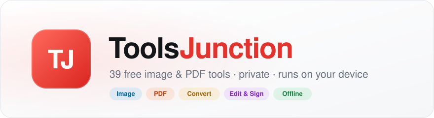
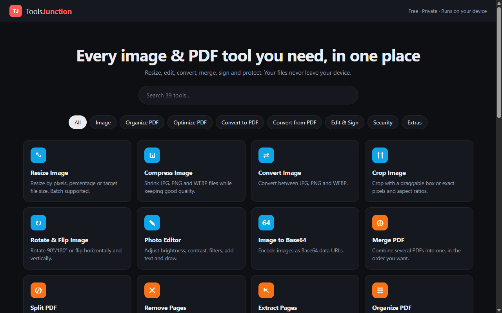
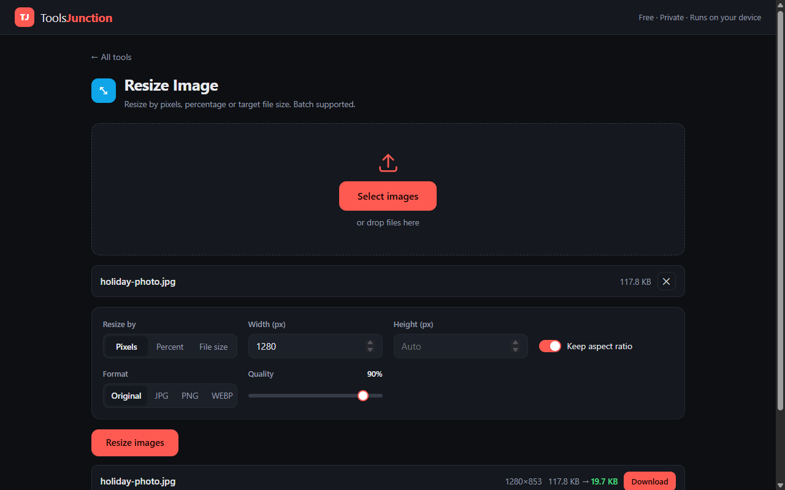

<div align="center">

<picture>
  <source media="(prefers-color-scheme: dark)" srcset=".github/assets/banner-dark.svg">
  
</picture>

<br><br>

**Resize, edit, convert, merge, sign and protect: everything in one place.**<br>
Your files never leave your device.

<br>

<a href="https://karthik6146.github.io/ToolsJunction/"></a>
&nbsp;
<a href="https://github.com/Karthik6146/ToolsJunction/releases/latest"></a>

<br><br>


</div>

<br>

<p align="center">
  
</p>

## ✨ Why ToolsJunction

|  |  |
|---|---|
| 🔒 **Private by design** | Every tool runs inside your browser. Nothing is uploaded, ever. |
| ⚡ **Fast on slow internet** | The home page is ~28 KB. Each tool loads only what it needs, then it's cached. |
| 📴 **Works offline** | After your first visit, the app opens and works without a connection. |
| 🖥️ **Install it anywhere** | Use it on the web, install it from Chrome/Edge, or get the Windows app. |
| 💸 **Free, no limits** | No sign-up, no watermarks, no file-size caps beyond your device's memory. |

## 🧰 Tools

<table>
<tr>
<td valign="top" width="50%">

**🖼️ Image**
- Resize: pixels, percent or target file size, batch
- Compress JPG / PNG / WEBP
- Convert between JPG, PNG, WEBP
- Crop with aspect ratios
- Rotate & flip
- Photo editor: filters, presets, text, drawing
- Image to Base64

**📑 Organize PDF**
- Merge · Split · Remove pages · Extract pages
- Organize: drag to reorder, rotate, delete
- Rotate pages

**⚙️ Optimize PDF**
- Compress PDF
- Repair PDF
- OCR: make scans searchable (11 languages)

</td>
<td valign="top" width="50%">

**📥 Convert to PDF**
- Images · Word (.docx) · Excel (.xlsx/.csv) · HTML · Text

**📤 Convert from PDF**
- Images (JPG/PNG) · Word · PowerPoint · Excel · Text

**✍️ Edit & Sign**
- Edit PDF: text, images, shapes, freehand, highlight, whiteout, sticky notes
- Sign: draw, type or upload a signature
- **DSC signing** (Windows app): sign with your USB token (ePass2003, ProxKey, mToken…) into the form's own signature fields, e.g. MCA / ROC e-forms. Earlier signatures stay valid.
- Redact: search & black out, content truly removed
- Fill forms · Watermark · Page numbers · Crop · Flatten · Metadata

**🔐 Security & extras**
- Protect with password · Unlock
- Read PDF aloud · Compare two PDFs

</td>
</tr>
</table>

<p align="center">
  
</p>

## 🚀 Get it

| Platform | How |
|---|---|
| 🌐 **Web** | Open **[karthik6146.github.io/ToolsJunction](https://karthik6146.github.io/ToolsJunction/)** |
| 📲 **Install from browser** | In Chrome or Edge, click *Install app* in the address bar. No extra download. |
| 🪟 **Windows** | Download the installer from **[Releases](https://github.com/Karthik6146/ToolsJunction/releases/latest)** (~108 MB). Windows SmartScreen may warn because the app isn't code-signed: click *More info → Run anyway*. |

## ⚠️ Good to know

- Word, Excel and HTML → PDF are basic-fidelity, and their pages become images (text isn't selectable).
- Compress PDF and Redact turn the affected pages into images.
- Edit PDF adds content on top of pages; to change existing text, use whiteout plus new text.
- Added text uses standard PDF fonts, which cover Latin characters only.
- OCR downloads its engine from a CDN the first time; your PDF stays on your device.
- DSC signing needs the Windows app: browsers can't talk to USB tokens. Your token's driver must be installed; Windows asks for the token PIN.
- Not included yet: PowerPoint → PDF, timestamp-server (TSA) signatures.

## 🛠️ Development

```bash
npm install
npm run dev          # http://localhost:5173
npm test             # unit tests (Vitest)
npm run build        # static site in dist/
npm run electron:dev # run the desktop app
npm run dist:win     # build the Windows installer into release/
```

**Stack:** Preact (React API) · TypeScript · Vite · pdf-lib (@cantoo fork) · pdf.js · tesseract.js · mammoth · SheetJS · docx · pptxgenjs · jsPDF · html2canvas · Electron

**Releases:** every push to `main` tests, builds and publishes the site to the `gh-pages` branch. Pushing a tag like `v1.0.2` builds the Windows installer and attaches it to a GitHub Release.

## 📄 License

[MIT](LICENSE) © Karthik Shakyawar
